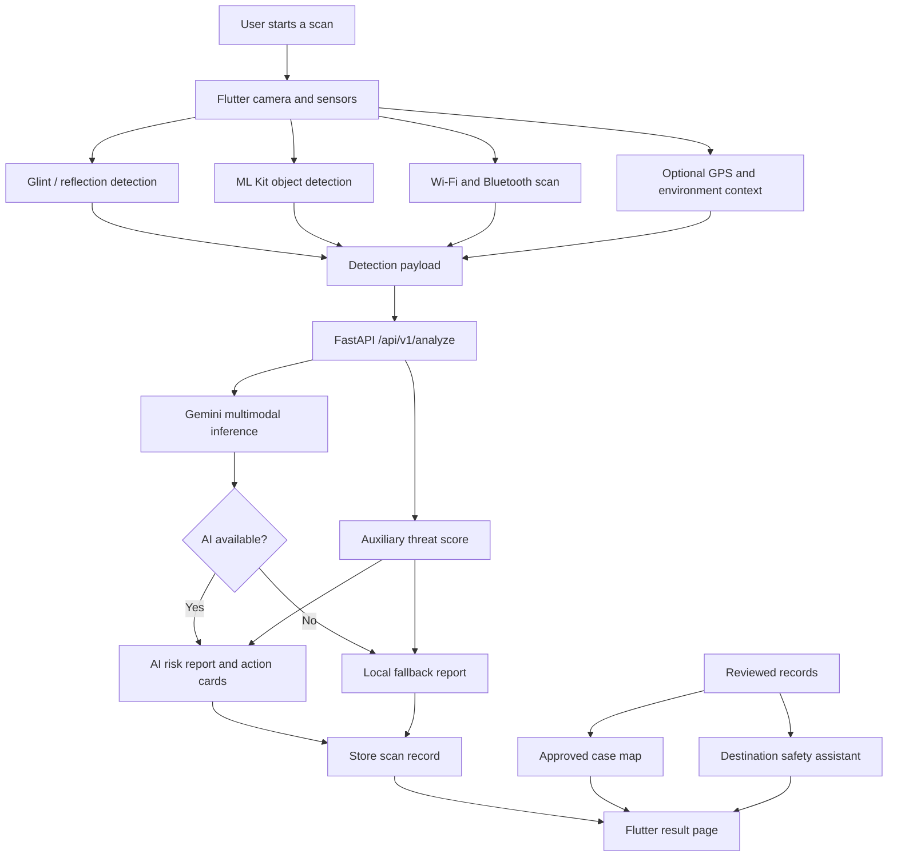

# No Pholebia

No Pholebia is a privacy and safety application that helps users identify possible hidden cameras or suspicious surveillance devices in an environment. The project combines a Flutter mobile application, on-device sensing, network discovery, and a Python-based multimodal AI inference service to produce a practical risk assessment and recommended actions.

> **Privacy and safety notice:** No Pholebia is intended as an assistive screening tool, not as a forensic instrument or a guarantee that an environment is safe. Always use professional assistance and contact local authorities when appropriate.

## Project Purpose

Hidden cameras can be difficult to identify through visual inspection alone. No Pholebia provides a multi-signal inspection workflow that helps users:

- Scan an environment with a mobile camera.
- Detect unusual optical reflections that may indicate a camera lens.
- Inspect possible objects with on-device object detection.
- Identify nearby Wi-Fi and Bluetooth devices that may require further inspection.
- Combine collected evidence with a backend AI analysis service.
- Receive a risk level, an explanation, recommended actions, and a short report that can be used when contacting venue staff or the police.
- Review approved historical reports on a map and request location-specific safety advice.

## Technology Stack

### Mobile application

- **Flutter / Dart** — cross-platform mobile application.
- **Camera** — live camera preview and image capture.
- **Google ML Kit Object Detection** — preliminary object classification and bounding boxes.
- **Image processing** — image conversion, brightness analysis, and optical-glint detection.
- **Sensors Plus** — device sensor data used during scanning.
- **Wi-Fi and Bluetooth scanning** — network and nearby-device inspection.
- **Geolocator** — optional location context for reports.
- **Flutter Map / LatLong2** — historical case map visualization.
- **Provider** — application state management.
- **Shared Preferences** — local preference and state persistence.

### Backend service

- **Python** — inference and API implementation.
- **FastAPI** — REST API server.
- **Pydantic** — request and response validation.
- **Google Gemini multimodal AI** — image-aware risk reasoning and safety advice.
- **SQLite-backed storage** — scan records, review status, statistics, and approved map cases.
- **Uvicorn** — local ASGI server.

The repository also contains native Flutter platform projects for Android, iOS, Linux, macOS, Windows, and Web.

## Main Features

### 1. Camera-based scanning

The app uses the device camera to inspect a scene and collect image evidence. It can record the overall scene and close-up images around detected reflection points.

### 2. Optical-glint detection

The scanning pipeline searches for unusual bright reflection points. These points are treated as supporting evidence rather than definitive proof of a hidden camera.

### 3. Object detection

Google ML Kit provides preliminary object classifications and bounding boxes. These results are sent to the backend as context for the final analysis.

### 4. Wi-Fi and Bluetooth inspection

The app can collect nearby network and Bluetooth information. Devices that appear suspicious are included as additional context for risk assessment. Common public Wi-Fi and Bluetooth signals should not be interpreted as proof of surveillance by themselves.

### 5. Multimodal AI risk assessment

The backend combines scan measurements, object-detection results, network signals, optional GPS context, and screenshots. When configured, Gemini produces:

- Risk level and percentage.
- A human-readable assessment summary.
- A short police or venue report script.
- An AI safety summary.
- Action cards with recommended next steps.

### 6. Local fallback behavior

If the AI service is unavailable, the backend returns a local fallback report based on the collected signals. This allows the application to remain usable during network interruptions or when an AI key has not been configured.

### 7. Historical case map and AI assistant

The backend supports reviewed case records and approved cases for map display. Users can also query the AI assistant with a destination and date to receive scenario-specific privacy and safety advice.

### 8. Review and monitoring endpoints

The backend includes endpoints for listing records, viewing individual records, reviewing reports, retrieving approved map cases, and checking basic statistics.

## System Architecture



### Request flow

1. The Flutter app collects camera frames, reflection candidates, object boxes, network information, Bluetooth information, and optional location data.
2. The app sends the scan payload to `POST /api/v1/analyze`.
3. The backend calculates an auxiliary signal score.
4. The backend sends the available evidence to the multimodal AI service when configured.
5. The backend falls back to a local report if the AI service is unavailable.
6. The result is stored with a pending review status and returned to the Flutter result page.
7. Approved records can later appear on the case map.

## App Screens and Demo

The project includes assets for the main application experience, including the logo, scan flow, AI assistant, map, result confirmation, and risk-status illustrations.

Suggested demo flow:

1. Launch the app and open the scan screen.
2. Grant camera, location, Bluetooth, and network permissions when requested.
3. Enter or select the environment context.
4. Perform a scan and allow the app to collect reflection and device signals.
5. Review the risk result, evidence summary, and action cards.
6. Open the AI assistant to request safety advice for a destination.
7. Open the case map to view approved historical reports.

Example project assets:

| Purpose | Asset |
| --- | --- |
| Application logo | [`assets/images/logo.png`](assets/images/logo.png) |
| Scan illustration | [`assets/images/scan.png`](assets/images/scan.png) |
| AI assistant illustration | [`assets/images/AI.png`](assets/images/AI.png) |
| Case map illustration | [`assets/images/map.png`](assets/images/map.png) |
| Confirmation illustration | [`assets/images/Check.png`](assets/images/Check.png) |

If you add screenshots or a recorded demonstration, place them in a repository directory such as `docs/images/` and link them here. Avoid including real locations, faces, device identifiers, personal information, API keys, or passwords in screenshots.

## Installation and Running

### Prerequisites

- Flutter SDK compatible with Dart SDK `^3.11.0`.
- A configured Android or iOS development environment for mobile testing.
- Python 3.10+ recommended for the backend.
- A physical device or emulator with the required camera and wireless permissions.
- Optional: a Google Gemini API key for multimodal AI analysis.

### 1. Clone the repository

```bash
git clone https://github.com/Athenahhw/no-pholebia.git
cd no-pholebia
```

The current development branch is `develop`:

```bash
git checkout develop
```

### 2. Install Flutter dependencies

```bash
flutter pub get
```

### 3. Configure the backend

Create a Python virtual environment inside `backend`:

```bash
cd backend
python3 -m venv .venv
source .venv/bin/activate
pip install fastapi uvicorn pydantic python-dotenv google-genai
```

On Windows PowerShell, activate the environment with:

```powershell
.venv\Scripts\Activate.ps1
```

If Gemini analysis is enabled, create `backend/.env` locally:

```env
GEMINI_API_KEY=your_key_here
```

Do not commit this file. Do not place API keys, passwords, tokens, or personal information in the repository.

### 4. Start the backend

From the `backend` directory:

```bash
python main.py
```

The API will listen on port `8000`. Interactive API documentation is available at `/docs`, for example:

```text
http://127.0.0.1:8000/docs
```

### 5. Start the Flutter app

From the repository root, replace the host with the IP address reachable from the mobile device:

```bash
flutter run --debug --dart-define=AI_ENDPOINT=http://127.0.0.1:8000/api/v1/analyze
```

For a physical phone connected to the same Wi-Fi network, use the development computer's LAN address instead of `127.0.0.1`:

```bash
flutter run --debug --dart-define=AI_ENDPOINT=http://192.168.x.x:8000/api/v1/analyze
```

The exact IP address depends on the local network and should not be hard-coded in public documentation or production builds.

## Backend API Overview

| Method | Endpoint | Purpose |
| --- | --- | --- |
| `GET` | `/` | Health check. |
| `POST` | `/api/v1/analyze` | Analyze a scan and return a risk report. |
| `POST` | `/api/v1/assistant/query` | Generate destination-specific safety advice. |
| `GET` | `/api/v1/records` | List stored scan records. |
| `GET` | `/api/v1/records/{record_id}` | Retrieve one scan record. |
| `POST` | `/api/v1/records/{record_id}/review` | Approve or reject a record. |
| `GET` | `/api/v1/records/approved-for-map` | Retrieve approved cases for the map. |
| `GET` | `/api/v1/stats` | Retrieve basic monitoring statistics. |

## My Contributions

As the project owner and primary contributor, my work focuses on the end-to-end integration of the No Pholebia prototype, including:

- Designing and implementing the Flutter application flow.
- Integrating camera capture, reflection detection, object detection, Wi-Fi scanning, Bluetooth scanning, and location context.
- Connecting the mobile client to the FastAPI analysis service.
- Implementing the backend inference pipeline and structured risk-report response.
- Integrating multimodal AI reasoning and the local fallback behavior.
- Building the result, AI assistant, case map, and safety-oriented user experience.
- Implementing record storage, review status, approved map cases, and monitoring endpoints.

If this repository is presented as a team project, update this section with the exact responsibilities of each team member before publishing the README.

## Known Limitations

- Detection results are heuristic and cannot guarantee that a hidden camera exists or does not exist.
- Optical reflections can be caused by ordinary objects such as screws, metal edges, water, or glossy surfaces.
- Wi-Fi and Bluetooth discovery depends on operating-system permissions, device capabilities, and platform restrictions.
- Some platforms limit background scanning or access to nearby-device information.
- Object detection is preliminary and should not be treated as a final classification.
- AI output may be incomplete, inaccurate, or affected by poor lighting and image quality.
- Location fallback values may be approximate when GPS permission is denied or unavailable.
- The development server and permissive CORS configuration are not suitable for production deployment without additional security controls.
- The current repository does not include a production authentication and authorization system for administrative review endpoints.
- A Gemini API key is optional for local fallback operation but required for Gemini-powered analysis.

## Future Improvements

- Add authenticated roles for users, reviewers, and administrators.
- Add encrypted transport and stronger production deployment defaults.
- Improve camera calibration, reflection filtering, and low-light performance.
- Add a dedicated on-device model to reduce network and AI-service dependency.
- Improve Bluetooth and Wi-Fi device fingerprinting while respecting platform privacy rules.
- Add automated tests for the mobile detection pipeline and backend API contracts.
- Add end-to-end tests for scan, review, map, and AI assistant flows.
- Add multilingual UI and report generation.
- Add privacy-preserving data retention controls and user-controlled deletion.
- Add documented screenshots, a hosted demo, and reproducible deployment instructions.

## Security and Privacy

This repository intentionally does not include API keys, passwords, access tokens, private credentials, or personal information. Before sharing a fork or demo recording:

- Keep `backend/.env` out of version control.
- Review screenshots for GPS coordinates, IP addresses, Bluetooth identifiers, faces, and other personal data.
- Use environment variables or a secure secret manager for credentials.
- Replace local network addresses with placeholders in public documentation.
- Do not use the application as the sole basis for accusations or emergency decisions.

## License

No license has been specified in the repository yet. Until a license is added, assume that the source code is not available for unrestricted reuse.
